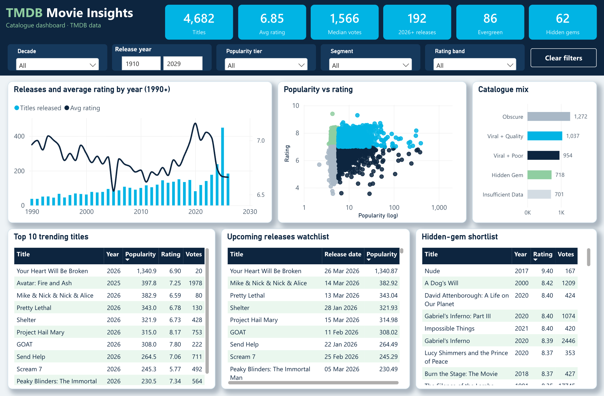

# TMDB Movie Insights

By Minh Tan Nguyen. An end-to-end analysis of 4,682 TMDB films: Python ETL, five streaming-industry business questions, and a Power BI catalogue dashboard.

AI & Business Analytics student at the University of South Florida. I use data to uncover trends, automate workflows, and tell stories that drive business decisions.

---

## About Me

| | |
|---|---|
| **Goal** | Transition into Product Management in the tech industry |
| **Focus** | Full ETL pipeline · Interactive dashboards · Business insights |
| **Stack** | Python · SQL · Tableau · Power BI · Git/GitHub |

---

## Projects

### Project 1 — TMDB Movie Insights

> Analysing 5,000 TMDB movie records to answer 5 real streaming industry business questions.

| Detail | Value |
|---|---|
| **Data source** | TMDB (The Movie Database) API |
| **Raw rows** | 5,000 |
| **Clean rows** | 4,682 |
| **Tools** | Python (stdlib) · Power BI |

**Key finding:** Popularity and audience rating are only weakly related: Pearson **r = 0.079**, Spearman rank **ρ = 0.230** (3,981 films with ≥ 50 votes). Trending content does not reliably satisfy audiences.

**[View Full Report →](https://m1nhn9.github.io/tmdb-movie-insights/project-1-tmdb-analysis/Entertainment_Industry_Data_Analysis_Portfolio.html)**

| File | Description |
|---|---|
| [`Entertainment_Industry_Data_Analysis_Portfolio.html`](https://m1nhn9.github.io/tmdb-movie-insights/project-1-tmdb-analysis/Entertainment_Industry_Data_Analysis_Portfolio.html) | Full visual analysis report |
| [`fetch_tmdb.py`](./project-1-tmdb-analysis/fetch_tmdb.py) | Extraction script: pulls the popular-movies list from the TMDB API (needs a `TMDB_API_KEY` environment variable). *Reconstructed in October 2026*: the original April 2026 extraction script was never committed, so running this pulls today's list, not the April snapshot. |
| [`clean_tmdb.py`](./project-1-tmdb-analysis/clean_tmdb.py) | Data cleaning + feature engineering script |
| [`tmdb_popular_movies.csv`](./project-1-tmdb-analysis/tmdb_popular_movies.csv) | Raw dataset (5,000 rows) |
| [`tmdb_clean.csv`](./project-1-tmdb-analysis/tmdb_clean.csv) | Cleaned dataset (4,682 rows × 15 cols) |
| [`powerbi/`](./project-1-tmdb-analysis/powerbi) | Power BI project: catalogue dashboard, detail pages and insights (open the `.pbip` in Power BI Desktop) |

#### Power BI dashboard

KPI header with filters, then releases and ratings by year, popularity vs rating, catalogue mix, a top 10 trending list, an upcoming releases watchlist and a hidden-gem shortlist. See [`powerbi/README.md`](./project-1-tmdb-analysis/powerbi/README.md) for how to open it.

